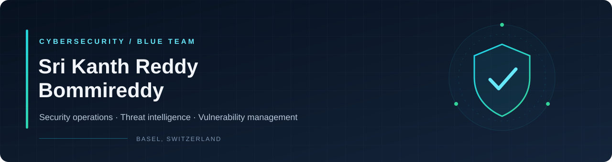

### Cloud Security · Identity & Access Management (IAM)

**Cyber Security master's student · Security Engineer, working student**

Basel, Switzerland

---

## About me

I'm **Sri Kanth Reddy Bommireddy**, pursuing a **master's in Cyber Security** and working as a **Security Engineer working student at the University of Basel**.

My main interests are **cloud security** and **Identity and Access Management (IAM)**. I want to build my career around securing cloud environments and managing how people, applications, and services access resources.

My current experience is in security operations, log investigation, and risk-based vulnerability management. I bring a background in computer science and data science, with Python as my preferred programming language.

## Where I want to specialize

| Focus | Topics I want to explore |
| :--- | :--- |
| **Cloud security** | Secure configurations, cloud security posture, logging, monitoring, and detection |
| **Identity & access management** | Authentication, authorization, least privilege, and role-based access control |
| **Identity protection** | Multi-factor authentication, access policies, and suspicious sign-in detection |
| **Identity lifecycle & governance** | Joiner–mover–leaver processes, access reviews, and privileged access management |
| **Federation & workload identities** | Single sign-on, identity federation, and access for applications and services |
| **Security automation** | Python for access reviews, log analysis, and repeatable security checks |

These are my areas of interest and learning direction. My practical experience is summarized below.

## Practical security experience

- SOC monitoring and investigation of firewall, proxy, DNS, and endpoint security logs.
- Risk-based vulnerability management.
- Work with Microsoft Defender, MISP, DNS RPZ, and operational security workflows.

## Tools & foundations

**Security:** Microsoft Defender · MISP · Wireshark · DNS RPZ  
**Programming & data:** Python · SQL · R  
**Academic background:** Computer science · Data science · Machine learning

## Learning & portfolio direction

I want to connect my security operations experience with practical cloud and identity security work.

- Explore how permissions and access policies affect cloud security.
- Build lab exercises around least privilege and identity lifecycle management.
- Analyze synthetic sign-in and audit logs for suspicious activity.
- Use Python to make access reviews and security checks more repeatable.
- Document lab findings, design choices, and lessons learned.

## Career direction

**Cloud Security Engineering · IAM Engineering · Identity Security**

Interested in learning, research, and collaboration in cloud and identity security.

---

**Secure the cloud. Protect identities. Grant only the access needed.**

